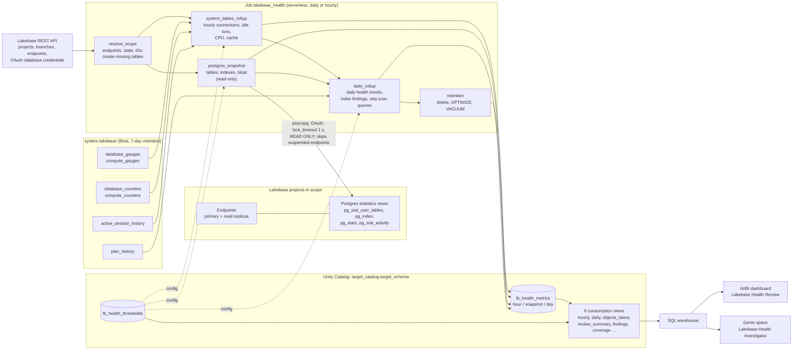
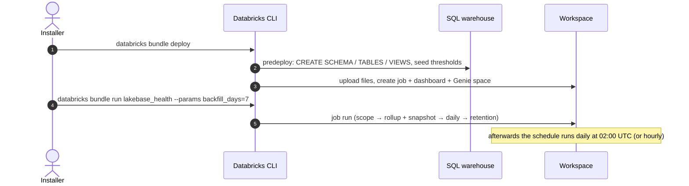

# Lakebase Health Check

A Databricks Asset Bundle that keeps **30 days of Lakebase health history** (and 90 days of daily trends) for a
biweekly health review of Lakebase Postgres projects.

| Component | What it does |
|---|---|
| **Job `lakebase_health`** | Serverless notebook job. Rolls `system.lakebase.*` telemetry up to hourly values per endpoint, snapshots the Postgres statistics views, computes 11 daily health trends and the schema-health lists, and applies retention. |
| **Delta tables** | `lb_health_metrics` (one narrow metric store for every grain) and `lb_health_thresholds` (reference lines and configuration) in `<target_catalog>.<target_schema>`, plus 9 consumption views. |
| **Dashboard** | *Lakebase Health Review* (AI/BI): review summary, daily trends with reference lines, hourly runtime detail, schema health, data coverage. |
| **Genie space** | *Lakebase Health Investigator*, for ad-hoc questions over the views. |

Out of scope: real-time alerting (create SQL alerts on the views), raw telemetry
archive, per-query analytics, live monitoring (use the Lakebase *Monitoring* tab).

- [Architecture](#architecture)
- [Installation (customer guide)](#installation-customer-guide)
- [Using the dashboard and Genie](#using-the-dashboard-and-genie)
- [Upgrade and uninstall](#upgrade-and-uninstall)
- [Parameters](#parameters)
- [Data model](#data-model)
- [Troubleshooting](#troubleshooting)
- [Validation log](#validation-log-dev-2026-11-10) · [Implementation notes](#implementation-notes) · [Developer guide](#developer-guide)

---

## Architecture



**Deployment flow:** `databricks bundle deploy` first runs a pre-deploy hook (`scripts/bootstrap_tables.py`). The
hook creates the schema, tables, threshold seeds and views on the SQL warehouse. The bundle then creates the job,
dashboard and Genie space. The Genie space needs its tables to exist when it is created, which is why the hook
runs first.



Job DAG:

```
resolve_scope ──┬──► system_tables_rollup ──┐
                └──► postgres_snapshot ─────┴──► daily_rollup ──► retention
```

**Safety properties of the Postgres snapshot:** every session runs with `default_transaction_read_only = on`,
`lock_timeout = 1 s` (the snapshot gives up instead of queueing behind a migration), a 30 s
`statement_timeout` (120 s for the bloat queries), and one short read-only transaction per query. Endpoints that
are not running are skipped and never woken. A failure on one endpoint does not fail the task.

---

## Installation (customer guide)

Plan for about 30 minutes. Steps 1–4 are one-time setup by an admin; steps 5–8 are the deployment itself.

### What you need

| Item | Who usually provides it |
|---|---|
| A Databricks workspace with Lakebase projects | — |
| Workspace preview **Lakebase Observability in System Tables** enabled | Workspace admin |
| `SELECT` on `system.lakebase` for the run identity | Account / metastore admin |
| A Unity Catalog catalog where a new schema can be created | Catalog owner |
| A SQL warehouse (serverless recommended) | Workspace admin |
| A service principal for the job (recommended) or a user | Workspace admin |
| Owner (or `CAN MANAGE`) on each Lakebase project in scope, to create the Postgres role | Project owner |
| A machine with **Databricks CLI ≥ 1.3.0** (tested 1.23.0), **python3**, and `git` | Installer |

### Step 1 — Install and authenticate the Databricks CLI

```bash
# macOS / Linux (see https://docs.databricks.com/dev-tools/cli/install for other options)
curl -fsSL https://raw.githubusercontent.com/databricks/setup-cli/main/install.sh | sh
databricks --version                     # must be >= 1.3.0

# OAuth login; creates a profile in ~/.databrickscfg
databricks auth login --host https://<your-workspace-host> --profile DEFAULT
```

The bundle's `default` target uses the `DEFAULT` profile. To use another profile, add `--profile <name>` to
every `bundle` command below.

### Step 2 — Get the code

```bash
git clone <repository-url> lakebase-health-check     # or download and unzip the release archive
cd lakebase-health-check
```

### Step 3 — Check the observability preview

1. In the workspace **Previews** page, enable **Lakebase Observability in System Tables**.
2. Connected to each endpoint in scope (SQL editor or `psql`), run:
   ```sql
   SHOW neon_monitor.log_capture_enabled;     -- must be on
   SHOW databricks.o11y_exporter_enabled;     -- must be on
   ```
   If either is `off`, restart the endpoint.
3. Confirm telemetry is arriving:
   ```sql
   SELECT project_name, max(ts) FROM system.lakebase.compute_gauges GROUP BY 1;
   ```

### Step 4 — Create the run identity and grant access

A **service principal** is recommended so the job does not depend on a person's account.

1. **Create the service principal** (Settings → Identity and access → Service principals → Add). Note its
   **Application ID**. Give the person who will deploy the **Service principal: User** role on it.
2. **Unity Catalog grants**, run by a metastore admin. `<sp>` is the application ID:
   ```sql
   GRANT USE CATALOG ON CATALOG system TO `<sp>`;
   GRANT USE SCHEMA, SELECT ON SCHEMA system.lakebase TO `<sp>`;
   GRANT USE CATALOG ON CATALOG <target_catalog> TO `<sp>`;
   ```
   The schema is created by the deployer in step 6. Its grants come in step 7.
3. **Optional, for the *New sequential-scan queries* trend and query text:** add the service principal to the
   `databricks_pii_access` group. Without it, query text and plans are masked and that trend shows *not available*.
4. **Lakebase project access:** in each project in scope, open **Permissions** and give the service principal
   **CAN USE**. This is needed to generate database credentials. For `project_name=ALL` it must be able to list
   projects.
5. **Postgres role on every branch in scope**, granted `pg_read_all_stats`. Choose one way:
   - **Notebook:** import `src/setup/create_pg_roles.py` into the workspace and run it as a project owner. Set
     `project_name`, `run_identity` = the application ID and `identity_type` = `SERVICE_PRINCIPAL`. Run once with
     `dry_run=true`, then with `dry_run=false`.
   - **Manually:**
     ```bash
     databricks postgres create-role projects/<project>/branches/<branch> --role-id lb-health \
       --json '{"spec":{"identity_type":"SERVICE_PRINCIPAL","postgres_role":"<sp>"}}'
     ```
     then, connected to the endpoint as the project owner:
     ```sql
     GRANT pg_read_all_stats TO "<sp>";
     ```
   **Bloat estimates** read `pg_stats`, which only shows columns the role may `SELECT`. With
   `pg_read_all_stats` alone, most tables report *bloat unknown*. To get bloat for every table, also run
   `GRANT pg_read_all_data TO "<sp>"` (read access to table data; `grant_read_all_data=true` in the notebook).
   Otherwise bloat is estimated only for readable tables.

### Step 5 — Configure the bundle

Edit the `default` target in `databricks.yml`, or pass values on the command line (`--var name=value`):

| Variable | Set to |
|---|---|
| `warehouse_id` | **Required.** SQL warehouse ID (SQL Warehouses → your warehouse → Connection details) |
| `target_catalog_name` | Catalog for the tables (default `main`) |
| `target_schema_name` | Schema to create (default `lb_health_check`) |
| `project_name` | Comma-separated Lakebase **project IDs** (the `<id>` in `projects/<id>`), or `ALL` |
| `frequency` / `schedule_cron` | `daily` + `0 0 2 * * ?` (default), or `hourly` + `0 0 * * * ?` |
| `failure_notification_emails` | Optional list of e-mails for job failures |

To run the job as the service principal, uncomment the `run_as` block in the `default` target and set
`run_as_service_principal`:

```yaml
targets:
  default:
    default: true
    workspace:
      profile: DEFAULT
    run_as:
      service_principal_name: ${var.run_as_service_principal}
    variables:
      run_as_service_principal: "<sp-application-id>"
      warehouse_id: "<warehouse-id>"
      target_catalog_name: "<catalog>"
      project_name: "<project-a>,<project-b>"
```

### Step 6 — Validate and deploy

```bash
databricks bundle validate
databricks bundle deploy
```

`deploy` prints `lakebase-health-check bootstrap: tables and views ready`, then creates the job, dashboard and
Genie space. The deployer needs `USE CATALOG` and `CREATE SCHEMA` on the target catalog. It must also be able
to use the SQL warehouse.

> If another bundle named `lakebase-health-check` was already deployed by the same user to the same workspace,
> the two share deployment state. Check with `databricks bundle summary` before the first deploy.

### Step 7 — Grant the run identity access to the new schema

```sql
GRANT USE SCHEMA, SELECT, MODIFY, CREATE TABLE ON SCHEMA <target_catalog>.<target_schema> TO `<sp>`;
```

Skip this if the job runs as the deploying user, who owns the schema.

### Step 8 — First run with backfill, then verify

```bash
# rebuild the 7 days of history still in system.lakebase, then compute daily trends
databricks bundle run lakebase_health --params backfill_days=7
```

Verify:

```sql
-- one rollup_ok and one snapshot_ok (or snapshot_skipped) row per endpoint
SELECT * FROM <catalog>.<schema>.lb_health_coverage ORDER BY day DESC;
-- trend status per endpoint
SELECT trend_id, endpoint_id, status, latest_value, reference_value
FROM <catalog>.<schema>.lb_health_review_summary WHERE period_days = 14 ORDER BY status_rank, trend_id;
```

Open the dashboard with `databricks bundle open lb_health_review`.

What to expect on day one:
- Hourly metrics and the runtime trends (connections, idle-in-transaction, CPU, cache) cover the backfilled week.
- Bloat, dead rows, full scans of large tables and the index lists start with the first Postgres snapshot, since Postgres statistics have no history.
- *Unused* index findings need 30 days of snapshots and show as *unused candidate* until then.

The schedule then runs automatically: daily at 02:00 UTC, or hourly.

### Step 9 — Share with reviewers

| Resource | Grant |
|---|---|
| Dashboard | Share → **CAN VIEW** to the reviewers' group. The dashboard uses embedded credentials, so viewers need no table grants. |
| Genie space | Share → **CAN RUN**. Genie runs queries as the user, so also grant `USE CATALOG` on the catalog, `USE SCHEMA, SELECT` on the schema, and **CAN USE** on the warehouse. |
| Thresholds | Reviewers who tune reference lines need `MODIFY` on `lb_health_thresholds`. |

---

## Using the dashboard and Genie

| Page | Use it for |
|---|---|
| **Review summary** | Red / amber / green counts and the status table for every trend × endpoint. Choose the review period (7 / 14 / 30 days) in the filter bar. |
| **Daily trends** | One chart per health trend, one series per endpoint, with the grey reference line. |
| **Runtime detail** | Hourly connections, idle-in-transaction, CPU and cache for the last 30 days. |
| **Schema health** | Top bloat, large tables with dead rows, sequential-scan queries, and invalid / unused / duplicate indexes. |
| **Data coverage** | Whether the job ran and whether telemetry arrived, per endpoint and day. |

**Tuning thresholds** needs no redeploy. Edit `lb_health_thresholds`; the dashboard picks it up immediately and
the job reads it at the start of each run:

```sql
UPDATE <catalog>.<schema>.lb_health_thresholds SET value = 0.80, updated_at = current_timestamp()
WHERE threshold_id = 'T4';            -- "CPU utilization (busiest hour)": 70% -> 80%
```

Reference lines are not effective-dated: a change re-judges history against the new standard.

**Genie examples:** "Which trends are red this period?", "Show CPU p95 by hour for the last 7 days", "List unused
indexes bigger than 50 MB", "When was the last autovacuum on the tables with the most dead rows?"

---

## Upgrade and uninstall

**Upgrade:** pull the new version, then run `databricks bundle deploy` again. The pre-deploy hook updates the views
and adds new columns. Data in `lb_health_metrics` and edits in `lb_health_thresholds` are kept.

**Uninstall:**

```bash
databricks bundle destroy            # removes the job, dashboard and Genie space
```

The tables are not bundle resources, so `destroy` leaves them in place. To remove the data too:

```sql
DROP SCHEMA <target_catalog>.<target_schema> CASCADE;
```

Optionally drop the Postgres role: `databricks postgres delete-role projects/<p>/branches/<b>/roles/lb-health`.

---

## Parameters

Bundle variables (`databricks.yml`). The ones the code needs are also job parameters, so a manual run from the UI
can override them.

| Variable | Default | Description |
|---|---|---|
| `target_catalog_name` | `main` | Catalog for the tables and views |
| `target_schema_name` | `lb_health_check` | Schema (created if missing) |
| `project_name` | `lb-health-check` | Comma-separated Lakebase project IDs, or `ALL` |
| `frequency` | `daily` | `daily` (48 h lookback, bloat every run) or `hourly` (3 h lookback, bloat on the first run after 00:00 UTC) |
| `schedule_cron` | `0 0 2 * * ?` | Quartz cron (UTC). Use `0 0 * * * ?` for hourly; `resolve_scope` warns on a mismatch |
| `warehouse_id` | *(required)* | SQL warehouse for the dashboard, Genie and the pre-deploy bootstrap |
| `retention_days` | `30` | Days kept for `grain IN ('hour','snapshot')` |
| `trend_retention_days` | `90` | Days kept for `grain = 'day'`. Minimum 60: the 30-day review period compares with the prior 30 days, and unused-index detection keeps each index's first-seen date in day rows |
| `run_as_service_principal` | `""` | Application ID for `run_as` (see step 5) |
| `pg_lock_timeout_ms` | `1000` | `lock_timeout` for the snapshot (gives up instead of queueing behind DDL) |
| `pg_statement_timeout_ms` | `30000` | `statement_timeout` for `pg_stat_*` queries |
| `pg_bloat_statement_timeout_ms` | `120000` | `statement_timeout` for the two bloat queries |
| `snapshot_all_databases` | `true` | Every non-template database, or `databricks_postgres` only |
| `idle_in_txn_source` | `ash` | `ash` (system table) or `pg_activity` (point-in-time fallback) |
| `failure_notification_emails` | `[]` | E-mails notified when the job fails |

Run-time-only job parameters:
- **`backfill_days`** (0–7, default 0): widens the hourly lookback to N days and has the daily rollup recompute
  the last N complete days. Use it after the first deploy or after an outage. Snapshot-based trends (bloat, dead rows, full scans of large
  tables, index lists) cannot be backfilled.
- **`daily_as_of`** (`YYYY-MM-DD`): recomputes the days before that date. This is a test aid; pass tomorrow's date
  to compute a partial today.

Configuration read by the job at the start of each run, from `lb_health_thresholds` where `kind = 'config'`:
- `cfg_large_table_min_rows` (100 K)
- `cfg_bloat_min_wasted_bytes` (100 MB)
- `cfg_unused_index_min_bytes` (10 MB)
- `cfg_unused_index_window_days` (30)
- `cfg_long_xact_seconds` (60)
- `cfg_very_long_xact_seconds` (300)

Seeds are inserted only when missing, so edits survive redeploys.

---

## Data model

`lb_health_metrics` holds one narrow row per `(ts, grain, project_id, branch_id, endpoint_id, compute_id,
datname, object_type, object_name, metric)`. `project_id`, `branch_id` and `endpoint_id` are the **Lakebase API
IDs** (`projects/<project_id>/branches/<branch_id>/endpoints/<endpoint_id>`), not the UUIDs in `system.lakebase`.
Ratios are fractions (0.70); bloat is percent (30.0).

| View | One row per |
|---|---|
| `lb_health_hourly` | endpoint × hour: all hourly metrics as columns |
| `lb_health_daily` | endpoint × day: `t1_…`–`t11_…` |
| `lb_health_objects_latest` | table/index in the latest snapshot (rows, scans, size, bloat, autovacuum) |
| `lb_health_table_daily` | table × day: scan deltas, live/dead rows (week-over-week comparisons) |
| `lb_health_index_findings` | flagged index × day: `invalid / unused / unused_candidate / duplicate` |
| `lb_health_seq_scan_queries` | query × day: seq scans of large tables from `plan_history` |
| `lb_health_review_summary` | trend × endpoint × `period_days ∈ {7,14,30}`: status, latest, averages, days breached |
| `lb_health_coverage` | endpoint × day: job runs vs hours with telemetry |
| `lb_health_endpoints` | endpoint: `endpoint_type` (read_write = primary / read_only = replica), last state |

**Metric catalog:**

| grain | object_type | metrics |
|---|---|---|
| hour | endpoint | `conn_count_avg, conn_util_p95, conn_util_max, max_connections_min, idle_in_txn_time_ms, session_time_ms, idle_in_txn_share, idle_in_txn_max_age_ms, idle_in_txn_over_60s_count, idle_in_txn_over_300s_count, cpu_util_avg, cpu_util_p95, cpu_util_max, cpu_busiest_core_max, host_logical_cpus_max, cpu_per_connection, lfc_hits, lfc_misses, lfc_hit_rate, lfc_working_set_60m_max, lfc_size_limit_min, lfc_working_set_fit`, `rollup_ok` (coverage) |
| snapshot | table | `n_live_tup, n_dead_tup, seq_scan(_delta), seq_tup_read(_delta), idx_scan(_delta), hours_since_autovacuum, bloat_pct, bloat_bytes, bloat_is_na` |
| snapshot | index | `idx_scan(_delta), index_bytes, index_is_valid, index_backs_constraint, bloat_pct, bloat_bytes, bloat_is_na` |
| snapshot | endpoint | `snapshot_ok, snapshot_skipped`, fallback `idle_in_txn_*` |
| day | endpoint | `t1_conn_util_busiest_hour … t11_new_seq_scan_queries` |
| day | index | `index_invalid, index_unused, index_unused_candidate, index_duplicate` |
| day | query | `seq_scan_query_count` |

**Health trends and reference lines** (edit them in `lb_health_thresholds`; the key column is `threshold_id`):

| Trend | Daily column (`lb_health_daily`) | Measures | Default reference | `threshold_id` |
|---|---|---|---|---|
| Connection utilization (busiest hour) | `t1_conn_util_busiest_hour` | p95 of connections / `max_connections` in the busiest hour | 70% | `T1` |
| Long idle-in-transaction sessions | `t2_idle_in_txn_over_60s_count` | sessions idle inside a transaction for more than 60 s | any > 0 | `T2` |
| Idle-in-transaction time share | `t3_idle_in_txn_share` | idle-in-transaction time / session time | 10% | `T3` |
| CPU utilization (busiest hour) | `t4_cpu_util_busiest_hour` | p95 CPU utilization in the busiest hour | 70% | `T4` |
| CPU per connection | `t5_cpu_per_connection` | average CPU utilization / average connections | prior 14-day average | `T5` |
| Cache hit rate | `t6_lfc_hit_rate` | local file cache hits / (hits + misses) | below 99% | `T6` |
| Working set vs. cache size | `t7_working_set_fit` | 60-minute working set / cache size | 80% | `T7` |
| Table and index bloat | `t8_max_bloat_pct` | max bloat % over objects wasting ≥ 100 MB | 30% | `T8` |
| Dead rows on large tables | `t9_dead_rows_large_tables` | dead rows summed over tables with ≥ 100 K live rows | none (watch for growth) | `T9` |
| Full scans of large tables | `t10_seq_scan_ratio_large_tables` | rows read by sequential scans / live rows, per day | 10 | `T10` |
| New sequential-scan queries | `t11_new_seq_scan_queries` | queries that started sequentially scanning a large table | any > 0 | `T11` |

**Status logic** (`lb_health_review_summary`): the period is `[yesterday − N + 1, yesterday]` UTC, compared with
the equally long prior window.

| Status | Meaning |
|---|---|
| `red` | the latest day breaches the reference line |
| `amber` | an earlier day in the period breached |
| `green` | no day breached |
| `info` | no reference line (*Dead rows on large tables*, or *CPU per connection* before a prior period exists) |
| `unknown` | no data |
| `not_available` | *New sequential-scan queries* when query plans are masked |

---

## Troubleshooting

| Symptom | Fix |
|---|---|
| `Zero projects resolved` | Check `project_name` (API project IDs such as `my-project`, not UUIDs) and **CAN USE** for the run identity. |
| `rollup_ok` value 0, `max_source_ts` null | No telemetry in the lookback. Either the endpoint was suspended, or the observability preview / compute settings are off (step 3). |
| `snapshot_ok` value 0, `password authentication failed` | The run identity has no Postgres role on that branch (step 4.5). |
| `snapshot_skipped` rows | Expected for suspended endpoints, which are never woken. Schema metrics resume when the endpoint runs. |
| *New sequential-scan queries* shows `not_available` | Add the run identity to `databricks_pii_access`, or grant `SELECT` on `system.lakebase`. |
| Many `bloat_is_na = 1` | `pg_stats` is not readable for those tables, or they were never analyzed (step 4.5). |
| Deploy fails creating the Genie space ("schema does not exist") | The pre-deploy bootstrap did not run (python3 missing, or warehouse unreachable). Run `python3 scripts/bootstrap_tables.py --catalog C --schema S --warehouse W` and deploy again. |
| `bundle deploy` fails creating a job that runs as an SP | The deployer needs the **Service principal: User** role on that SP. |
| Job fails with `PERMISSION_DENIED` on the schema | Step 7 grants are missing for the run identity. |
| Trend status all `unknown` right after install | The review period ends yesterday. Run once with `backfill_days=7`, or wait one day. |
| `index_unused_candidate` never becomes `index_unused` | It needs `cfg_unused_index_window_days` (30) days of observation. |

---

## Validation log (dev, 2026-11-10)

| Check | Result |
|---|---|
| ASH `backend_state` encoding | PG17 `BackendState` numbering. State 3 (`running`) `query_age_ms` tops out at about 300 s (statement timeouts). State 4 (`idle in transaction`) **is sampled** (8.6 K rows over 3 days workspace-wide). Source B (ASH) kept, with states `(4, 6)` in `metrics.ASH_IDLE_IN_TXN_STATES`. The controlled test (hold `BEGIN; SELECT 1;` open and watch) is **still to do**; the fallback is `idle_in_txn_source=pg_activity`. |
| Statement masking | As the deploying user: 0 of 177 `plan_history` rows masked, so *New sequential-scan queries* is available. Not yet tested as a service principal. |
| `pg_stats` visibility | `table_bloat.sql` as the deploying user: 140 of 151 tables `is_na`. The cause (never analyzed vs. no column access) is not yet separated; see step 4.5. |
| LFC units | `lfc_working_set_size_60m` and `lfc_size_limit` are both **bytes** (`lfc_used` ≈ `lfc_size_limit`, working set < `total_size`). No conversion. |
| Telemetry lag | `max(ts)` in `compute_gauges` is about 10–25 s behind `now()`, so the 3 h hourly lookback is ample. |
| Counter cadence | `compute_counters` interval p5 = p50 = p95 = 30 s. The minute-bucket join holds. |
| IDs | `system.lakebase.project_name` = API project ID; `project_id` = project UID; `branch_id` / `endpoint_id` = `br-…` / `ep-…` UIDs. The rollup joins on UIDs. |
| `neon.compute_id` | Readable, so snapshot rows carry the real compute id. |
| Idempotency | Two runs in the same hour leave 8,518 rows in both cases. |
| Daily rollup | Exercised with `daily_as_of` and `backfill_days=7`: all 11 daily trends, invalid / duplicate / unused-candidate indexes and the seq-scan regex all produced correct rows on the test project. |
| Missing-object recreate | Dropping `lb_health_coverage` and running the job recreated it in `resolve_scope`. |
| Scope isolation / suspended endpoint | **Not yet run.** The test endpoint was already active, and only one project was in scope. |

## Implementation notes

- **`CLUSTER BY (grain, project_id, metric, ts)`**: liquid clustering allows at most 4 columns, so `endpoint_id`
  was dropped (it is the least selective, since most endpoints are `primary`).
- **Genie space** is defined inline (`serialized_space:` YAML) in `resources/lb_health_genie.genie_space.yml`, not
  in `genie/*.geniespace.json`. DAB inlines `file_path` contents verbatim, so `${var.*}` table identifiers would not
  be interpolated. The space has no `permissions:` block; share it in the UI (step 9) or add a block with your group.
- **Dashboard** queries use bare view names, and the resource sets `dataset_catalog` / `dataset_schema`. Details:
  - The review period is a parameter-bound filter (7/14/30, default 14).
  - The **`period_end` filter is not implemented**; the summary always ends yesterday.
  - Reference lines are a grey `reference: <label>` series over the last 30 days.
  - Counters cannot be coloured per tile, so status colour appears in the counter titles and the table's status
    label.
  - *CPU per connection* reports `info` until a prior period exists.
- **No job-level `environment_key`**: serverless notebook tasks take their environment from the notebook, and
  `psycopg[binary]` is `%pip`-installed where needed. The Lakebase API is called over REST with the preinstalled
  SDK; upgrading `databricks-sdk` in-notebook caused a SIGABRT next to Spark Connect.
- **No `create_tables` task.** All DDL lives in `src/lb_health/ddl.py`. It runs on every `bundle deploy`
  (pre-deploy bootstrap, which is when definitions change), and `resolve_scope` runs it at job time only if an
  object is missing. This saves about 40 s per run.
- **Snapshot `ts`** is the run hour (not minute), so a rerun in the same hour overwrites the snapshot. **Counter
  deltas** are keyed without `compute_id`: after a resume, the reset rule (current < previous → current) counts
  scans since the resume instead of dropping the first delta.
- **Long idle-in-transaction sessions**: a session is counted once, in the hour it first exceeded the threshold,
  so the daily sum does not double-count long sessions.
- **Day grain** is rewritten with DELETE + MERGE for the recomputed days, so findings that no longer apply
  disappear.
- **Index findings** are written under the branch's read_write endpoint, with `idx_scan_delta` summed across all
  endpoints of the branch. `first_seen` is carried forward in the finding's detail, so the 30-day "unused" window
  survives the 30-day snapshot retention.
- **Bloat**: `bloat_pct` is floored at 0 (btree estimates can be negative), and `is_na` objects are excluded from
  the bloat trend and the bloat list.
- **Retention**: day rows are kept 90 days, with a minimum of 60.
- **Extras**:
  - views: `lb_health_endpoints`, `lb_health_table_daily`, `lb_health_coverage`
  - parameters: `idle_in_txn_source`, `backfill_days`, `daily_as_of`, `failure_notification_emails`
  - the pre-deploy bootstrap
- `OPTIMIZE` runs on Sundays (UTC) and `VACUUM` daily. In hourly mode, both run only on the 02:00 UTC run.

---

## Developer guide

```bash
# unit tests (pure Python, no Spark/Postgres)
uv run --with pytest pytest tests -q

# dev deployment (schedule paused by development mode); point it at your dev workspace and catalog
databricks bundle deploy -t dev --profile <dev-profile> --var "warehouse_id=<id>" --var "target_catalog_name=<dev-catalog>"
databricks bundle run lakebase_health -t dev --profile <dev-profile> --params project_name=<test-project>

# optional: keep your dev values out of git in .databricks/bundle/dev/variable-overrides.json (git-ignored)
#   {"target_catalog_name": "<dev-catalog>", "warehouse_id": "<id>"}
# then: databricks bundle deploy -t dev --profile <dev-profile>

# print the DDL without executing it
python3 scripts/bootstrap_tables.py --catalog C --schema S --warehouse W --print-only
```

Repository layout:

```
databricks.yml                         bundle, variables, targets, predeploy hook
resources/                             job, dashboard, genie space
src/00_resolve_scope.py, 02_… – 05_…   job notebooks (no 01: DDL is in lb_health/ddl.py)
src/lb_health/                         shared package (config, lakebase_api, pg, metrics, store, views, ddl, sql/)
src/setup/create_pg_roles.py           optional one-time role setup (run as project owner)
scripts/bootstrap_tables.py            pre-deploy DDL bootstrap
dashboards/lb_health_review.lvdash.json
tests/test_formulas.py
```

`system.lakebase` is Beta. Every telemetry column reference lives in
`src/lb_health/sql/system_hourly_rollup.sql`, `src/lb_health/metrics.py` and the `plan_history` queries in
`src/04_daily_rollup.py`.

## Risks and assumptions
- `system.lakebase` is Beta, so column names may change.
- Counter resets undercount and never overcount.
- Suspended endpoints produce no snapshot deltas.
- 30 days is the minimum to call an index unused.
- Thresholds are untuned defaults.
- Objects are identified by name, so a rename looks like a new object.
